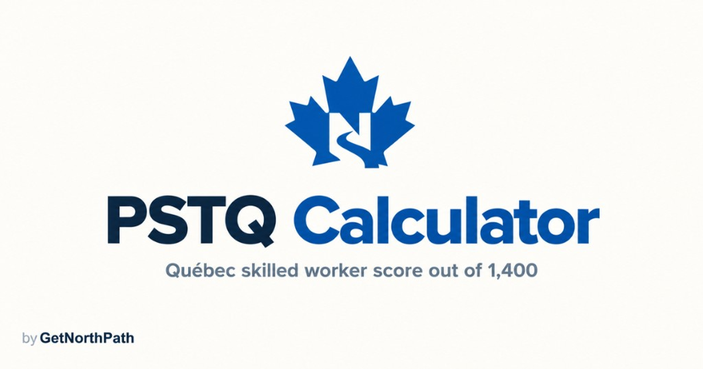

# PSTQ Score Calculator



> **A free estimate of Québec’s skilled-worker score. Not an official Arrima result.**

**Free PSTQ score calculator and guides** from [GetNorthPath](https://www.getnorthpath.com). Estimate a score out of **1,400 points** on the Programme de sélection des travailleurs qualifiés (PSTQ) grid in force since 20 June 2025, see which of the four streams scores you, check French hard gates, and compare the estimate with published 2026 Arrima rounds.

[](https://pstq.getnorthpath.com)
[](https://github.com/Sidd-is-dev/PSTQ-Score-Calculator)
[](https://www.getnorthpath.com)
[](docs/FEATURES.md#languages)

This repository is the **public information hub** for the product: what the calculator does, how scoring and streams work, and where the numbers come from. It is **not** the application source-code repository. The live site is [pstq.getnorthpath.com](https://pstq.getnorthpath.com).

Documentation in this hub was checked against the live English site on **6 October 2026**. Invitation history on the site covers rounds **through 24 September 2026**. If this hub and Québec or IRCC disagree, the official page wins.

---

## What this product does

The PSTQ Score Calculator is a **free companion** for people estimating a Québec skilled-worker score. You enter a profile, the site assigns a stream from occupation (TEER and regulated-profession status), estimates points on the published grid, flags hard gates, and shows how that estimate sits against the latest published Arrima round for that stream.

A higher score can improve ranking in the Arrima pool. It does **not** guarantee an invitation, a Certificat de sélection du Québec (CSQ), or permanent residence.

We do **not** replace the Ministère de l'Immigration, de la Francisation et de l'Intégration (MIFI), Arrima, or IRCC. Official Québec and IRCC pages always win.

---

## Key features

| Feature | Description |
| --- | --- |
| **1,400-point estimate** | Capital humain (max 520), Réponse aux besoins du marché du travail (max 700), Facteurs d'adaptation (max 180) |
| **4 streams** | Highly qualified, intermediate and manual, regulated professions, exceptional talent |
| **Hard-gate checks** | French (and other stream) minimums are flagged before the point total is treated as decisive |
| **Verified vs partial factors** | Exact tables are labeled verified; ranges and interpolations are labeled partial |
| **2026 draw history** | Nine invitation rounds through 24 September 2026, with published score ranges where Québec published them |
| **5 tools** | TEF/TCF level converter, CLB reference, NOC/TEER finder, PEQ closure check, CSQ to PR timeline |
| **Guides, occupations, regions** | Plain-language pages for streams, scoring, documents, six occupations, and six region profiles |
| **2 languages** | English unprefixed; French at `/fr/…` |
| **Free to use** | No account is required to run the estimate |

### Live calculator

<div align="center">

<a href="https://pstq.getnorthpath.com/"></a>

<br>

[Open the calculator](https://pstq.getnorthpath.com/) · [Methodology](https://pstq.getnorthpath.com/methodology) · [2026 draws](https://pstq.getnorthpath.com/draws)

</div>

---

## How a visit works

```
1. Enter age, household, and occupation   →  Stream is assigned from TEER and regulation
2. Enter Québec, education, and French    →  Estimate out of 1,400
3. Read the hard-gate result              →  A missed French minimum blocks the outcome
4. Compare with the latest published round →  Thresholds are not a fixed pass mark
5. Optional next step                     →  Guide, tool, or a consultation request
```

Detail: [docs/WORKFLOW.md](docs/WORKFLOW.md)

---

## Four different questions

| Question | What answers it |
| --- | --- |
| **Score estimate** | This calculator, from the published grid. Independent. Not an official Arrima score. |
| **Eligibility** | Stream conditions, French minimums, experience, status, and permits. A high score can still be ineligible. |
| **Invitation threshold** | Each Arrima round’s published range, after the round. Not published in advance. |
| **Official decision** | MIFI invites and issues a CSQ. IRCC decides permanent residence afterward. |

---

## Who it’s for

- **Applicants** estimating a PSTQ score before or after an Arrima expression of interest
- **People comparing streams** (TEER 0–2, TEER 3–5, regulated professions, exceptional talent)
- **People who were planning around the PEQ**, which closed to new applications in November 2025
- **Readers who want the grid, the gates, and the 2026 rounds in one place**, with sources

> *Not affiliated with MIFI, the Gouvernement du Québec, or IRCC. The calculator is an independent estimate, not eligibility, and not legal advice.*

---

## Documentation in this repo

| Doc | What it covers |
| --- | --- |
| [ABOUT.md](ABOUT.md) | What the calculator is, and why this repository exists |
| [docs/PRODUCT.md](docs/PRODUCT.md) | Purpose, users, journey, limits, privacy |
| [docs/FEATURES.md](docs/FEATURES.md) | Verified feature and URL inventory |
| [docs/PAGES.md](docs/PAGES.md) | Page and route inventory |
| [docs/WORKFLOW.md](docs/WORKFLOW.md) | Profile → stream → score → gates → draws → next steps |
| [docs/SCORING-MODEL.md](docs/SCORING-MODEL.md) | 1,400-point structure and verified vs partial factors |
| [docs/STREAMS.md](docs/STREAMS.md) | The four PSTQ streams |
| [docs/TOOLS.md](docs/TOOLS.md) | Converters and checkers |
| [docs/OCCUPATIONS.md](docs/OCCUPATIONS.md) | Occupation pages on the site |
| [docs/REGIONS.md](docs/REGIONS.md) | Regional bonus scoring |
| [docs/DRAWS.md](docs/DRAWS.md) | 2026 invitation history as published on the site |
| [docs/SOURCES.md](docs/SOURCES.md) | Québec and IRCC sources |
| [docs/PRIVACY.md](docs/PRIVACY.md) | Verified privacy and contact behavior |

Index: [docs/README.md](docs/README.md)

---

## Links

### PSTQ Score Calculator (this product)

- **Live site:** [pstq.getnorthpath.com](https://pstq.getnorthpath.com)
- **Calculator:** [pstq.getnorthpath.com](https://pstq.getnorthpath.com/)
- **Methodology:** [pstq.getnorthpath.com/methodology](https://pstq.getnorthpath.com/methodology)
- **Draws:** [pstq.getnorthpath.com/draws](https://pstq.getnorthpath.com/draws)
- **FAQ:** [pstq.getnorthpath.com/faq](https://pstq.getnorthpath.com/faq)
- **Guides:** [pstq.getnorthpath.com/guide](https://pstq.getnorthpath.com/guide)
- **Tools:** [pstq.getnorthpath.com/tools](https://pstq.getnorthpath.com/tools)

### Official sources (always win)

- **PSTQ program (Québec):** [skilled worker selection program](https://www.quebec.ca/en/immigration/permanent-workers/skilled-worker-selection-program)
- **2026 Arrima invitations:** [invitation rounds](https://www.quebec.ca/en/immigration/permanent/skilled-workers/skilled-worker-selection-program/invitation/2026)
- **Points document (PDF):** [Document explicatif, arrêté du 20 juin 2025](https://cdn-contenu.quebec.ca/cdn-contenu/immigration/publications/fr/Pointage_criteres.pdf)
- **Procedures guide (PDF):** [Guide des procédures d'immigration, ch. 3 §1](https://cdn-contenu.quebec.ca/cdn-contenu/adm/min/immigration/publications-adm/gpi/02_GPI_ch3_sect1_PSTQ.pdf)
- **IRCC:** [canada.ca immigration](https://www.canada.ca/en/services/immigration-citizenship.html)

Full list: [docs/SOURCES.md](docs/SOURCES.md)

### GetNorthPath (parent)

- **Website:** [getnorthpath.com](https://www.getnorthpath.com)
- **Walkthrough:** [contact](https://www.getnorthpath.com/contact?intent=walkthrough&tool=pstq-calculator#book)
- **Privacy:** [getnorthpath.com/privacy](https://www.getnorthpath.com/privacy)
- **Terms:** [getnorthpath.com/terms](https://www.getnorthpath.com/terms)

---

## License

Documentation in this repository is available under the **MIT License**. See [LICENSE](LICENSE).

© 2026 GetNorthPath. The PSTQ Score Calculator is free to use. Not affiliated with MIFI, the Gouvernement du Québec, or IRCC. The calculator is an **estimate**, not official government software, eligibility, or legal advice.
